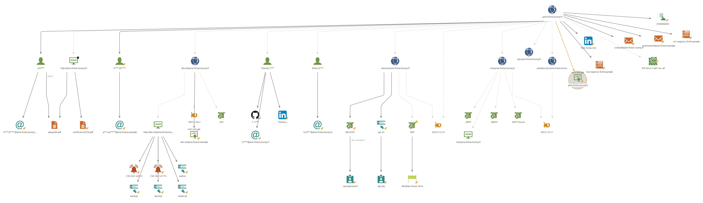

# Surface d'attaque exposée — PME Fictive — TLP:AMBER — 2026-10-27

## 1. Synthèse

La PME fictive expose les services web, `extranet`, `mail` et un ancien serveur `dev-old` sur le domaine `pme-fictive.lizurey.fr`. 

**C1 (critique)** : un dépôt GitHub public contient une clé d'API et des identifiants de base de données en clair.

**C2 (élevée)** : `dev-old` expose Apache 2.4.49 avec plusieurs dossiers accessibles dont /backup/, SSH, avec des CVE suggérées par Shodan . 

**C3 (élevée)** : l'extranet expose directement le service RDP sur Internet. Le risque global est **élevé**, principalement à cause des secrets publiés et des services d'administration exposés. Aucun identifiant ni secret n'a été testé et aucune exploitation n'a été menée.

## 2. Périmètre identifié

| Nom                                   | IP             | Services (ports)                              | Technologies et versions                                            | Source           | Confiance |
| ------------------------------------- | -------------- | --------------------------------------------- | ------------------------------------------------------------------- | ---------------- | --------- |
| `www.pme-fictive.lizurey.fr`          | `203.0.113.10` | HTTP 80, HTTPS 443                            | nginx 1.24.0                                                        | Shodan           | B2        |
| `extranet.pme-fictive.lizurey.fr`     | `203.0.113.10` | HTTP 80, HTTPS 443, RDP 3389                  | nginx 1.24.0 ; Windows Server 2016 (`EXTRANET-SRV`)                 | Shodan, GitHub   | B2        |
| `mail.pme-fictive.lizurey.fr`         | `203.0.113.11` | SMTP 25, Submission 587, HTTPS 443, IMAPS 993 | Postfix ; nginx ; Zimbra Web Client ; Dovecot                       | Shodan, `dig` MX | B2        |
| `autodiscover.pme-fictive.lizurey.fr` | `203.0.113.11` | CNAME vers `mail`                             | Service de découverte de messagerie                                 | crt.sh, DNS      | A2        |
| `dev-old.pme-fictive.lizurey.fr`      | `198.51.100.7` | HTTP 80, SSH 22                               | Apache HTTP Server 2.4.49 (Unix) ; OpenSSH 7.6p1 suggéré par Shodan | Shodan, Nuclei   | A2        |
| `vpn.pme-fictive.lizurey.fr`          | —              | Aucun ; NXDOMAIN                              | Certificat historique expiré en février 2025                        | crt.sh, DNS      | A2        |
| `pme-fictive.lizurey.fr`              | —              | MX                                            | MX vers `mail` ; SPF `v=spf1 mx -all`                               | `dig`            | A2        |

Les hôtes `www` et `extranet` partagent `203.0.113.10`, tandis que `mail` et `autodiscover` partagent `203.0.113.11`. `dev-old` est isolé sur `198.51.100.7`, mais son certificat expiré et son nom indiquent un serveur potentiellement oublié.

## 3. Constats par ordre de priorité

**C1 (critique). Secrets de production dans un dépôt public.** **Vu :** `export_erp.py` contient une clé d'API, un compte et un mot de passe de base de données, ainsi que l'adresse privée `10.20.0.15`. 
**Risque :** ces secrets peuvent permettre un accès non autorisé s'ils sont encore valides et révèlent l'architecture interne.  
**Source :** [dépôt GitHub](https://github.com/PME-fictive/outils-extranet/blob/main/export_erp.py), A1 ; aucun secret n'a été testé.  
**Recommandation :** révoquer et remplacer immédiatement les secrets, rechercher leur présence dans l'historique Git, utiliser un gestionnaire de secrets et vérifier les journaux d'accès. Former les utilisateurs à l'utilisation de GitHub.

**C2 (élevée). Serveur `dev-old` obsolète et exposé.** **Vu :** Apache 2.4.49 répond sur HTTP ; Nuclei confirme `apache-detect` et un listing `/backup/` ainsi que plusieurs paths. Shodan suggère CVE-2021-41773 et CVE-2021-42013, mais Nuclei ne confirme ni ces CVE ni une RCE.  
**Risque :** fuite de fichiers, compromission potentielle et exposition d'un serveur probablement hors maintenance.  
**Source :** [Shodan](https://www.shodan.io/host/198.51.100.7), B2 ; Nuclei, A2.  
**Recommandation :** décommissionner ou isoler immédiatement l'hôte, supprimer le listing, mettre à jour Apache et examiner les journaux.

**C3 (élevée). RDP directement exposé sur Internet.** **Vu :** le port 3389 et une bannière Windows Server 2016 sont visibles sur `203.0.113.10`.  
**Risque :** brute-force, réutilisation d'identifiants compromis et exposition de l'extranet à des vulnérabilités RDP.  
**Source :** [Shodan](https://www.shodan.io/host/203.0.113.10), B2 ; configuration GitHub, A2.  
**Recommandation :** ne plus exposer 3389 depuis Internet, imposer un VPN avec MFA pour accéder au service d’accès à distance et limiter les comptes autorisés.

**C4 (moyenne). Adresses nominatives et fuite simulée.** **Vu :** la convention `prenom.nom@` est observée ; deux adresses du domaine apparaissent dans la fuite simulée.  
**Risque :** spear-phishing, password spraying et credential stuffing, sans présumer de la validité des mots de passe.  
**Source :** theHarvester et fichier de fuite simulée, B3/A2.  
**Recommandation :** réinitialiser les comptes concernés, activer la MFA, prévenir les personnes et surveiller les authentifications.

## 4. Personnes et identifiants exposés

La convention observée est `prenom.nom@pme-fictive.lizurey.fr`. 

Un fichier correspondant à une fuite de données permet de retrouver deux mails correspondant au nom de domaine : `m***.d***@pme-fictive.lizurey.fr` et `t***.l***@pme-fictive.lizurey.fr`. 

Grace à Google Dorks on apprend que T**** L**** est Responsable informatique chez PME Fictive SAS.

Wayback machine permet de retrouver une personne Paul M*** qui était responsable informatique au 2022-05-10, `p***.m***@pme-fictive.lizurey.fr`. On apprend que T*** L*** a pris sa succession autour du 2024-09-03.

Un commit est attribué à `t***.l***` ; cette corrélation augmente le risque de ciblage, sans fournir d'information sur sa vie privée. 

Une personne a été identifié en utilisant Exiftool sur le PDF, il s'agit de K**** B****, son mail à été trouvé en utilisant TheHarvester  `k***.b**@pme-fictive.example`.

Recommandations : Réinitialisation de tout les mots de passe, suppression des comptes qui ne sont plus utilisés, formation des utilisateurs à l'utilisation des réseaux sociaux et à github. 

## 5. Ce que nous n'avons pas fait et pourquoi

Aucune tentative d'identifiant, d'accès à la base de données ou d'utilisation de la clé d'API n'a été effectuée. Aucun exploit, téléchargement de fichier sensible ou test de RCE n'a été mené. Les actions actives sont limitées à la cible de bac à sable autorisée et respectent la charte ainsi que les articles 323-1 et suivants du Code pénal. 

Nuclei confirme des signatures et des réponses observables ; il ne démontre pas une compromission. 

Les résultats Shodan sont des observations datées et les chemins `/admin/` et `/old-site/` mentionnés par `robots.txt` n'ont pas été confirmés accessibles.

## 6. Journal de bord (annexe)

| Horodatage | Action | Outil | Source (URL ou fichier) | Résultat | Cotation |
|---|---|---|---|---|---|
| 2026-10-27 | Certificats et sous-domaines | crt.sh, subfinder, dnsx | [crt.sh](https://crt.sh/?q=%25.pme-fictive.lizurey.fr) | Six noms identifiés ; `dev-old` et `vpn` ont un certificat expiré | A2 |
| 2026-10-27 | DNS de messagerie | dig | `pme-fictive.lizurey.fr` | MX vers `mail` ; SPF strict `v=spf1 mx -all` | A2 |
| 2026-10-27  | Services exposés | Shodan | [198.51.100.7](https://www.shodan.io/host/198.51.100.7), [203.0.113.10](https://www.shodan.io/host/203.0.113.10), [203.0.113.11](https://www.shodan.io/host/203.0.113.11) | Ports, bannières, RDP et CVE suggérées | B2 |
| 2026-10-27  | Adresses et hôtes publics | theHarvester | crt.sh, DuckDuckGo, Bing, HackerTarget | Quatre adresses et cinq hôtes ; convention `prenom.nom@` | B3 |
| 2026-10-27  | Dépôt et organisation | GitHub, API GitHub | [organisation](https://api.github.com/users/pme-fictive), [dépôt](https://github.com/pme-fictive/outils-extranet) | Un dépôt public et commits attribués à Thomas Lefebvre | A2 |
| 2026-10-27  | Secrets et architecture | Lecture statique | [export_erp.py](https://github.com/PME-fictive/outils-extranet/blob/main/export_erp.py) | Secrets en clair et adresse privée ; aucun secret testé | A1 |
| 2026-10-27  | Métadonnées PDF | exiftool | [plaquette.pdf](https://pme-fictive.lizurey.fr/plaquette.pdf) | Auteur, outils Adobe, Windows et chemin local révélés | A1 |
| 2026-10-27  | Validation d'exposition | Nuclei v3.11.1 | `http://dev-old.pme-fictive.lizurey.fr` | Apache 2.4.49 et `/backup/` confirmés ; CVE, `/admin/` et `/old-site/` non confirmés | A2 |

## 7. Carte de la surface d'attaque (annexe)

Les noms `www` et `extranet` partagent une IP et l'extranet ajoute un chemin RDP direct. Le dépôt public relie les secrets divulgués à l'API et à la base interne ; `dev-old` est un nœud isolé et potentiellement oublié. La relation avec les adresses exposées est un risque de ciblage, pas la preuve d'une compromission.

**TLP:AMBER :** cette fiche nomme une organisation fictive et décrit des expositions exploitables ; elle est destinée au groupe, à l'enseignant et aux personnes autorisées au débrief.

---

*Mathieu CRETEAU et Thomas Cazabat
